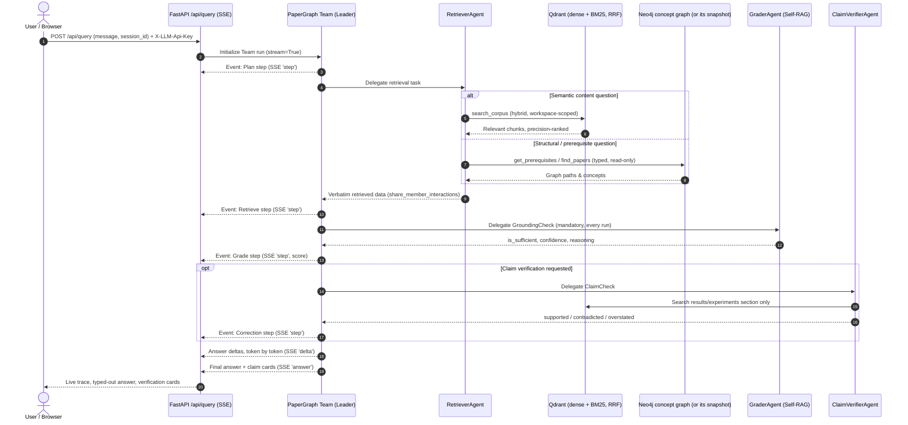

# PaperGraph

**An agentic RAG system that refuses to guess.** Ask it about a paper that isn't in its corpus, and it says so — plainly, once, with nothing tacked on. Ask it to check a claim, and it will tell you when a paper's abstract overreaches beyond what its own results actually show. Every retrieval, grading, and correction step streams live to the UI as it happens, not after the fact.

Built on [Agno](https://github.com/agno-agi/agno): a 5-agent team (Retriever, Grader, Sequencer, Jargon Decoder, Claim Verifier) coordinating over a hybrid Qdrant vector store + Neo4j concept graph, with real-time SSE streaming, multi-provider BYOK, and a RAGAS-scored eval harness.

**v2 is built to stay up for $0 and open instantly:** the public demo serves an embedded-Qdrant + graph snapshot exported from Neo4j (no database to pause or expire), the page and corpus load from a CDN, every live question runs on the visitor's own key, and the API sheds load with rate limits and concurrency caps instead of falling over. Load-tested to 1,000 concurrent streams. Design, capacity math and measurements: [`docs/SYSTEM_DESIGN.md`](docs/SYSTEM_DESIGN.md).

---

## See it catch something

Ingested paper **DuetRAG** claims a general retrieval improvement in its abstract. Asked to verify that claim against the paper's own results section, the ClaimVerifier agent found:

> **Overstated.** The claim is numerically accurate, but the paper's abstract frames it as a general improvement. The results section evaluates only **one dataset (HotPotQA)** with **one base model (LLaMA2-7B)** — no cross-dataset or cross-model validation is reported.

This isn't a canned demo response — it's a live structured `ClaimCheck` object (`is_supported=True, contradiction_found=False, overstated=True`) produced by an agent that searched the actual results section, compared it against the abstract's framing, and reported a nuance a flat true/false verdict can't express.

Ask about a paper genuinely outside the corpus, and the same discipline shows up as a refusal:

> This paper isn't in my ingested corpus yet, so I can't determine prerequisites from the graph.

No hedging, no "but based on general knowledge…" tacked on afterward. Getting agents to actually stop there — instead of quietly filling the gap with parametric knowledge — turned out to be one of the harder problems in this project. See below.

---

## What actually broke, and what that revealed

Portfolio projects usually hide the debugging. This one doesn't, because the bugs were more interesting than the features:

- **A single missing regex character silently broke all real-time streaming.** The SSE parser searched for the literal substring `\n\n` to detect frame boundaries — but the backend (`sse-starlette`) sends `\r\n\r\n`, which does not contain `\n\n` as a substring at all (`\r,\n,\r,\n` — no two `\n`s are adjacent). Every server response arrived correctly; the UI just never noticed, and sat at "running" forever. Confirmed via DevTools: the raw bytes were there, unparsed.

- **Two different agents can run the same correct query and reach opposite conclusions.** Gemini and Groq's `gpt-oss-120b`, given identical Cypher results confirming a paper existed in the graph, sometimes disagreed on whether it existed — because one model reliably read its own tool output before answering, and the other didn't always. The fix wasn't better Cypher; it was forcing every agent to state what a query returned before concluding anything from it.

- **A team leader can override a correct refusal with a wrong answer.** A sub-agent would honestly report "not in corpus" — and the team leader would still append a paragraph of general knowledge afterward, because "be helpful" outranked "be honest" by default. Fixed with an explicit hard rule: a refusal is the complete answer, full stop, nothing after it.

- **The demo died of inactivity, not traffic.** Free Neo4j AuraDB and Qdrant Cloud tiers reclaim idle instances — exactly what a portfolio demo is most of the time. v2 keeps both as the system of record but serves the public demo from a snapshot exported from them, so there's nothing left to pause.

- **The server froze at ~30 concurrent questions.** Each streamed query parked a thread from asyncio's default executor (`to_thread(queue.get)` per event) for its whole lifetime; around 30 open streams, every other request queued behind them. v2 consumes Agno's native async stream — 1,000 concurrent streams complete on one process, and a regression test holds `/api/health` responsive with 60 streams open.

- **Workspace isolation was a sentence in a prompt.** Agents wrote their own Cypher and were *asked* to filter by workspace. v2 gives agents typed, read-only tools whose workspace scope is bound by the server — no tool parameter can widen it.

- **`ragas==0.4.3` doesn't actually import**, due to a currently-open upstream bug (unconditionally importing a `langchain_community` submodule that's already been removed in current `langchain-community` releases). Pinned to `0.3.9` and patched the one broken import locally rather than chase a moving target across three interdependent packages.

- **The evaluation itself was lying about retrieval quality.** Initial context precision scored **0.42** — genuinely weak, and the honest baseline the reranker below was built to fix, not a number massaged away.

---

## Measured, not asserted

Real RAGAS scores from the eval harness (`eval/`), not marketing copy. These were measured on the v1 stack (bge-base embeddings via sentence-transformers, hosted Qdrant/Neo4j); v2 swaps in ONNX bge-small embeddings, a smaller optional reranker and drops reference sections from the index, so re-run `eval/run_evals.py` before quoting numbers for v2:

| Metric | Before reranking | What it measures |
|---|---|---|
| Faithfulness | 0.872 | Every claim in the answer traceable to retrieved context |
| Answer Relevancy | 0.864 | The answer actually addresses the question asked |
| Context Precision | **0.418** | Retrieved chunks are actually relevant (this was the weak point) |
| Context Recall | 0.597 | Retrieval found everything needed for a correct answer |

Context Precision being the clear laggard is *why* a cross-encoder pass was added on top of hybrid search — over-fetch candidates, re-score them against the real query with a slower but more accurate model, keep only the genuine top matches. Local, no API key, same philosophy as the embedder. (v1 used `BAAI/bge-reranker-v2-m3`, 2.2 GB; v2's optional `ENABLE_RERANKER` uses an ONNX MiniLM cross-encoder that fits serverless memory.)

Serving path under load (`loadtest/`, LLM simulated, retrieval real — details and caveats in [SYSTEM_DESIGN.md §6](docs/SYSTEM_DESIGN.md#6-load-test-measured)):

| Scenario | Result |
|---|---|
| 250 concurrent streams, 1 process | 100 % OK, time-to-first-event p95 120 ms, `/api/health` p50 19 ms |
| 1,000 offered, cap 250 / process | accepted runs p50 2.4 s (ideal ≈ 1.6 s); excess shed as 503 + `Retry-After` in p50 356 ms |
| 1,000 concurrent, 3 processes | 1,000 / 1,000 OK, time-to-first-event p95 95 ms |

---

## Architecture



---

## Stack

| Layer | Choice | Why |
|---|---|---|
| Agent framework | [Agno](https://github.com/agno-agi/agno) | Native `Team` delegation, structured outputs, async event streaming |
| Vector store | [Qdrant](https://qdrant.tech/) — server (full) or embedded in-process (demo) | Hybrid dense + BM25 with RRF fusion; same query code in both modes |
| Knowledge graph | [Neo4j](https://neo4j.com/) — system of record; snapshot export for the demo | `CITES` / `TEACHES` / `REQUIRES`, parameterized read-only Cypher |
| Embeddings / reranker | FastEmbed (ONNX): `BAAI/bge-small-en-v1.5`, `Qdrant/bm25`, optional MiniLM cross-encoder | No torch; small enough for serverless cold starts |
| LLM providers | Gemini / Groq / OpenRouter, **BYOK only** | Visitor's key per request, never stored or logged |
| Backend | FastAPI + `sse-starlette`, fully async | One coroutine per stream, cancel-on-disconnect |
| Abuse controls | Sliding-window rate limits (Upstash Redis or in-memory), concurrency gate, run timeouts | Shed load early and cheaply; see [SYSTEM_DESIGN.md](docs/SYSTEM_DESIGN.md) |
| Hosting | Vercel (static frontend on CDN + Python function) or the Docker image anywhere | $0, no idle-reclaimed dependencies |
| Evaluation | [RAGAS](https://docs.ragas.io) + contract tests against real Qdrant/Neo4j in CI | Quality and storage-profile parity, measured |
| Frontend | Hand-built HTML/CSS/JS | No build step; static corpus + recorded replays load instantly |

---

## Project layout

```
papergraph/
├── agents.py              # Team: Retriever, Grader, Sequencer, JargonDecoder, ClaimVerifier (BYOK)
├── tools.py               # The 5 typed, workspace-bound tools agents can call
├── server.py              # FastAPI: /api/query (SSE), /api/ingest, /api/graph, /api/papers, /api/models, /api/config
├── ratelimit.py           # Sliding-window rate limits (Upstash / memory) + concurrency gate
├── security.py            # Client identity, key header handling, redaction, cached key checks
├── event_mapper.py        # Agno events -> UI trace steps + token deltas + claim cards
├── stores/                # VectorStore / GraphStore interfaces
│   ├── qdrant_store.py    #   Qdrant hybrid search (server or embedded)
│   ├── neo4j_store.py     #   Neo4j, parameterized read-only Cypher; ETL writes
│   └── snapshot_graph.py  #   In-memory graph exported from Neo4j (demo)
├── etl.py                 # arXiv ingest -> Qdrant + Neo4j; `export` -> demo snapshot
├── snapshot/              # Exported demo data (graph.json, chunks.jsonl.gz, manifest.json)
├── frontend/              # index.html, data/corpus.json, replays/
├── api/index.py           # Vercel entrypoint
├── Dockerfile, docker-compose.yml, vercel.json
├── loadtest/sse_load.py   # Concurrent SSE load generator
├── eval/                  # RAGAS harness
├── tests/                 # Contract tests (real Qdrant/Neo4j), API, end-to-end team run
└── docs/                  # SYSTEM_DESIGN.md, DESIGN_DECISIONS.md
```

---

## Quickstart

### 1. Run the full stack (Qdrant + Neo4j + API)

```bash
git clone https://github.com/shoraaz/papergraph.git && cd papergraph
docker compose up -d --build        # http://localhost:8000 — ingestion enabled
```

### 2. Build the corpus and export the demo snapshot

Ingestion makes one LLM call per paper (concept extraction), so it needs a key once. Run the ETL from your machine against the compose databases:

```bash
python -m venv .venv && . .venv/bin/activate      # Windows: .venv\Scripts\activate
pip install -r requirements-dev.txt
cp .env.example .env                               # set STORE_PROFILE=full, REQUIRE_BYOK=false, GOOGLE_API_KEY=...
python etl.py ingest                               # rebuilds the original 19-paper corpus into Qdrant + Neo4j
python etl.py export                               # -> snapshot/ + frontend/data/corpus.json
```

`--ids …` or `--query "…"` ingest other papers. Commit `snapshot/` and `frontend/data/corpus.json` — that's what the public demo serves. Before deploying, set `STORE_PROFILE=demo` back (or remove it) in `.env`.

### 3. Record a few runs for keyless visitors (optional, recommended)

```bash
STORE_PROFILE=demo RECORD_RUNS_DIR=frontend/replays uvicorn server:app --port 8000
# ask 2-3 good questions in the UI with your key, then:
python scripts/build_replay_index.py
```

### 4. Deploy

**Vercel:** import the repo; no build settings needed (`vercel.json` serves `frontend/` from the CDN and `api/index.py` as the function). Optional env: `UPSTASH_REDIS_REST_URL` / `UPSTASH_REDIS_REST_TOKEN` (shared rate limits), `CORS_ORIGINS`.
**Any container host** (Cloud Run, Render, Fly, HF Spaces): `docker build -t papergraph . && docker run -p 8080:8080 papergraph`.

### Local development

```bash
python -m venv .venv && . .venv/bin/activate
pip install -r requirements-dev.txt
uvicorn server:app --reload --port 8000           # demo profile, reads snapshot/
docker compose up -d qdrant neo4j && python -m pytest -q   # contract tests use both
```

### Load test and evals

```bash
MOCK_LLM=true MAX_CONCURRENT_RUNS=250 QUERY_LIMIT_PER_MIN=1000 QUERY_LIMIT_PER_HOUR=10000 uvicorn server:app --port 8000 --workers 3 --timeout-keep-alive 75
python loadtest/sse_load.py --url http://localhost:8000 --users 1000
pip install -r eval/requirements.txt && GOOGLE_API_KEY=... REQUIRE_BYOK=false python eval/run_evals.py --limit 3
```

See [`eval/README.md`](eval/README.md) for metric definitions, [`docs/SYSTEM_DESIGN.md`](docs/SYSTEM_DESIGN.md) for the serving architecture, and [`docs/DESIGN_DECISIONS.md`](docs/DESIGN_DECISIONS.md) for the agent-level rationale.

---

## License

MIT.
