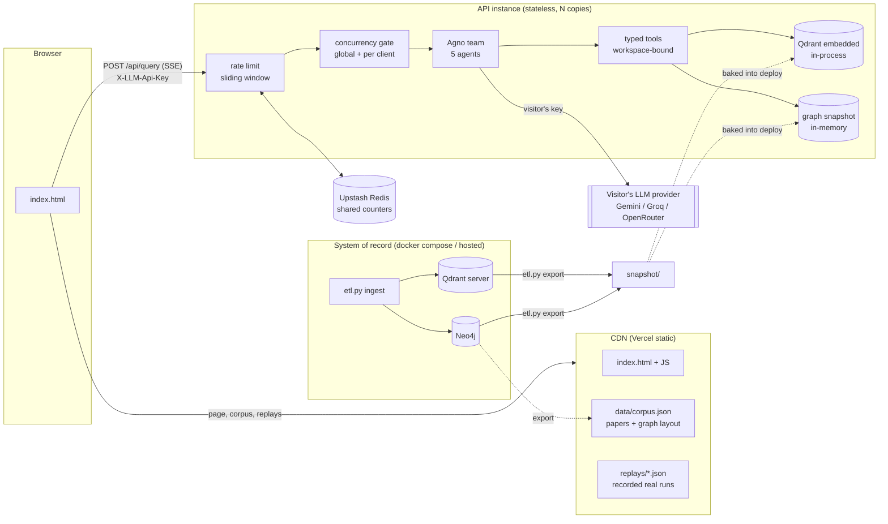

# PaperGraph v2 — System Design

How PaperGraph stays online for $0, opens instantly for a first-time visitor, and degrades predictably when far more people show up than it was sized for. Agent-level design (Self-RAG grading, refusals, claim verdicts) is in [DESIGN_DECISIONS.md](DESIGN_DECISIONS.md).

---

## 1. Constraints

| Constraint | Consequence |
|---|---|
| **$0 hosting, indefinitely** | No always-on paid database or server. Anything on a free tier must survive weeks of zero traffic. |
| **First load must be instant** | A visitor (often a recruiter, once) must never wait for a cold server to see the product. |
| **Visitors pay for their own LLM usage (BYOK)** | The server never holds provider keys; cost per request to the owner is ~0 regardless of traffic. |
| **Qdrant + Neo4j stay the data platform** | Ingestion, the graph model and hybrid vector search are the point of the project — not something to swap out for a cheaper toy. |
| **Must not fall over at 10k concurrent users** | It can't *serve* 10k concurrent LLM agent runs for free, but it must shed load cleanly and keep the cheap paths (page, corpus, replays) fully available. |

## 2. Why v1 went down, and why it was slow

* **Free database tiers pause on inactivity.** AuraDB Free pauses an instance after a few days without queries and deletes it after a few weeks paused; Qdrant Cloud's free cluster is suspended after about a week unused and later removed. These aren't trials that expire — they're idle reclamation, and a portfolio demo is idle most of the time. Keep-alive pings work until they don't, and they don't fix the next two problems.
* **Cold start ≈ a minute.** Render's free instance sleeps after 15 idle minutes. Waking it meant importing torch + sentence-transformers, downloading the BGE embedder (and, when enabled, a 2.2 GB reranker), then connecting to two remote databases — before the page could even list papers.
* **It froze at ~30 concurrent questions.** Each `/query` started a thread and then awaited `asyncio.to_thread(queue.get)` *per event*, which parks one of the default executor's ~32 threads for the life of every open stream. Around 30 open streams, every `to_thread` call in the process — including the ones other requests needed — queued behind them.
* **Data isolation was a prompt.** Agents wrote their own Cypher; "add `WHERE p.workspace_id IN [...]`" was an instruction in the system prompt, and the Cypher tool could write.

## 3. Architecture



### 3.1 Two storage profiles, one code path

| | `STORE_PROFILE=full` | `STORE_PROFILE=demo` (public) |
|---|---|---|
| Vectors | Qdrant server | Qdrant **embedded** in the API process (`AsyncQdrantClient(":memory:")`) |
| Graph | Neo4j | In-memory graph loaded from `snapshot/graph.json` |
| Written by | `etl.py ingest`, `/api/ingest` | nothing (read-only) |
| Populated from | arXiv | `etl.py export` **from Qdrant + Neo4j** |
| Runs where | `docker compose up`, or Qdrant Cloud / AuraDB | Vercel function / any container |

Agents never see either. They call five typed tools (`tools.py`), which call two narrow interfaces (`stores/base.py`): `VectorStore.search(query, workspaces, …)` and `GraphStore.prerequisite_inputs(paper, workspaces)` etc. The demo profile runs **the same Qdrant query code** (same collection schema, same dense + BM25 prefetch with RRF fusion), just in-process; the graph snapshot answers through the **same reading-order algorithm** as Neo4j (`build_prerequisite_report`).

**Keeping them honest:** `tests/test_graph_contract.py` and `tests/test_vector_contract.py` run one behavioural suite against embedded Qdrant, a real Qdrant server, the snapshot graph, a real Neo4j, *and* a snapshot exported from that Neo4j. CI runs Qdrant and Neo4j as service containers on every push, so the system-of-record path is exercised continuously even though the public demo never touches it.

**Why a snapshot is the right call here, not a compromise:** the corpus is tens of papers and changes only when the ETL runs — it's effectively static data. Serving static data from a database that bills (or expires) by uptime buys nothing; serving it from memory gives zero network hops and no shared bottleneck, and every API instance scales independently. The moment the data stops being static (per-user uploads at scale), the full profile is the answer — see §8.

### 3.2 Cold start

| Step | v1 | v2 |
|---|---|---|
| Page + corpus list + graph | API wake (~30–60 s) | **CDN, ~0 s** (`data/corpus.json`) |
| Watch a real run | needs API + key | **CDN, ~0 s** (`replays/*.json`, no key) |
| API process ready | torch import, model download, 2 DB connects | Python imports + load ~1–3 MB snapshot (measured 15–25 ms for the load itself; container `docker run` → healthy in **4.7 s** including interpreter start) |
| First live question | — | ONNX models load in the background on the first API hit (the page fires `/api/config` on load as a warm-up) |

Models are baked into the Docker image at build time. On Vercel they're downloaded to `/tmp` on a cold instance's first use.

## 4. Request lifecycle (`POST /api/query`)

Cheapest check first, so abuse is rejected before it costs anything:

| # | Check | Cost | Failure |
|---|---|---|---|
| 1 | Body ≤ 64 KB, schema, message ≤ 2 000 chars, ≤ 20 history turns, valid session id | µs | 413 / 422 |
| 2 | Rate limit per client: 6/min **and** 40/hour (sliding window) | 1 Redis round trip | 429 + `Retry-After` |
| 3 | Visitor key present (`X-LLM-Api-Key`) | µs | 401 |
| 4 | Key accepted by provider (one cheap authenticated GET, cached by SHA-256 for 10 min) | ~100–300 ms once per key | 401 |
| 5 | Concurrency slot: ≤ `MAX_CONCURRENT_RUNS` per instance, ≤ 2 per client | µs | 503 / 429 + `Retry-After` |
| 6 | Run: async Agno stream, ≤ 150 s, ≤ 6 tool calls per agent, ≤ 10 delegations | — | error step, slot released |

A client disconnect cancels the run (`aclosing` around `team.arun`), so a closed tab stops spending the visitor's tokens. The slot is released from both the stream's `finally` and the response's background task (idempotent), so a client that disconnects before the first byte can't leak capacity.

**Why load shedding instead of a queue:** a run holds an SSE connection for 30–120 s. Queueing excess requests just turns them into timeouts later, after they've held a socket and the visitor's patience. A fast 503 with `Retry-After` is the honest answer, and the UI shows it as "at capacity, try again in ~15 s".

## 5. Capacity model: 10,000 concurrent users

"10k concurrent users" is three very different loads:

1. **10k people open the page.** HTML, `corpus.json`, replays — all static on the CDN. The API isn't involved. *Fully served.*
2. **A fraction ask live questions.** Assume 10 % → 1,000 concurrent agent runs. Each run is ~6–10 LLM calls over 30–90 s, almost all of it waiting on the provider. The API's job per run is I/O multiplexing plus a few ms of retrieval.
3. **Abuse.** One client scripting requests. Bounded to 6/min, 40/hour, 2 in flight.

For (2), per-instance capacity is set by CPU, not by threads or connections (v2 holds a coroutine per stream, not a thread). Measured knee for one Python process on one core is ~250 concurrent streams of the compressed mock workload (§6). Real runs emit events more slowly (LLM-paced) but add Agno's per-token processing for every member agent, which the mock doesn't exercise — so production uses a conservative `MAX_CONCURRENT_RUNS=40` per instance until real traces say otherwise. 1,000 concurrent runs ÷ 40 ≈ **25 instances**, which Vercel (Fluid compute) or Cloud Run (`--concurrency 40`) autoscale to without configuration. Past the platform's instance limit, step 5 sheds load cleanly instead of degrading everyone.

**The real bottleneck is the LLM provider, and BYOK distributes it:** every visitor brings their own quota, so 1,000 runs are 1,000 separate rate-limit buckets at the provider — not 1,000 runs against the owner's single key (which a free tier would cap at a handful of RPM).

**Data layer at this load:** demo profile — none; retrieval is in-process and scales linearly with instances. Full profile — each instance keeps a ≤ 50-connection Neo4j pool; reads are small, parameterized, read-transaction queries on indexed properties. Beyond a few dozen instances: Neo4j read replicas / Aura scaling and Qdrant replicas (§8).

## 6. Load test (measured)

`loadtest/sse_load.py` opens N concurrent `/api/query` streams, each from a distinct simulated client, against the server in `MOCK_LLM=true` mode: the LLM is replaced by scripted 0.6 s waits per "model call", but retrieval is real (embedded Qdrant hybrid search + graph lookup through the same tools). It also samples `/api/health` while the streams are open.

Setup: one 4-vCPU cloud VM running both the server and the load generator (a single Python process parsing every stream — itself a bottleneck at the high end); hashing embedder (the ONNX models couldn't be downloaded in that environment; bge-small query embedding adds a few ms of CPU per uncached query); fixture corpus. Ideal duration of one scripted run ≈ 1.6 s, ~25 SSE events.

| Scenario | Result | Time to first event p50 / p95 | Run p50 / p95 | `/api/health` p50 during |
|---|---|---|---|---|
| 1 process, 100 concurrent | 100 / 100 OK | 5 ms / 74 ms | 1.64 s / 1.71 s | 4 ms |
| 1 process, 250 concurrent | 250 / 250 OK | 5 ms / 120 ms | 1.85 s / 2.09 s | 19 ms |
| 1 process, 500 concurrent | 500 / 500 OK | 173 ms / 590 ms | 3.57 s / 7.64 s | 129 ms |
| 1 process, 1,000 concurrent | 1,000 / 1,000 OK, CPU-saturated | 813 ms / 2.08 s | 10.5 s / 11.6 s | 492 ms |
| 1 process, cap 250, 1,000 offered | 699 OK, 298 shed (503), 3 connection resets | 32 ms / 482 ms | 2.44 s / 4.30 s | 71 ms |
| 3 processes, cap 250 each, keep-alive 75 s | **1,000 / 1,000 OK** | 23 ms / 95 ms | 2.54 s / 7.40 s | 37 ms |

What this shows, and what it doesn't:

* The v1 failure mode is gone: 1,000 concurrent streams on one process all complete (v1 stalled near 30), and the health endpoint keeps answering (`tests/test_server.py` pins this with 60 streams).
* One process degrades past ~250 concurrent streams; the concurrency cap converts overload into fast 503s while accepted runs stay near ideal latency, and adding processes restores 100 % success — horizontal scaling works because the API is stateless.
* The 3 connection resets in the capped single-process run were a keep-alive race (uvicorn's 5 s idle timeout closing connections the client was reusing). With `--timeout-keep-alive 75` (now the container default) the 3-process run had zero.
* Not measured: real LLM latency/throughput, Agno's per-token overhead on real model streams, Vercel's own concurrency behaviour. These numbers describe the serving path only.

Reproduce:

```bash
MOCK_LLM=true MAX_CONCURRENT_RUNS=250 QUERY_LIMIT_PER_MIN=1000 QUERY_LIMIT_PER_HOUR=10000 \
  uvicorn server:app --port 8000 --workers 3 --timeout-keep-alive 75
python loadtest/sse_load.py --url http://localhost:8000 --users 1000
```

## 7. Failure modes

| Failure | Behaviour |
|---|---|
| API cold / asleep | Page, corpus list, graph and replays still load from the CDN; first live question waits for the instance. |
| Upstash unreachable | Rate limiter fails **open** to per-instance memory counters (logged once). Limits get per-instance-loose, the API stays up. |
| Visitor key invalid | 401 before any agent starts (cached verdict, 60 s for invalid keys). |
| Provider rate-limits or errors mid-run | First provider error is shown once (key redacted), stream ends, slot released. |
| Run exceeds 150 s | Stopped with an explanatory error step; protects the visitor's quota. |
| Client closes tab | Run cancelled, slot released. |
| Instance at capacity | 503 + `Retry-After: 15`; UI shows "at capacity". |
| One client floods | 429 after 6/min or 40/hour; ≤ 2 runs in flight. |
| Snapshot missing / wrong embedder | Empty corpus with a log line / startup error naming the model mismatch (manifest check) rather than silently wrong vectors. |
| Neo4j / Qdrant down (full profile) | `/api/health` returns 503 until init succeeds; the demo profile has no such dependency. |

## 8. Security

* **BYOK:** keys travel only in the `X-LLM-Api-Key` header — never URLs (v1's `GET /models?api_key=` put keys in logs) or logged bodies. Stored in the browser's `sessionStorage` by default (`localStorage` only if the visitor opts in). The server holds a key for one request, redacts it (plus anything key-shaped) from every error, never logs headers, and `ModelChoice.__repr__` masks it. With `REQUIRE_BYOK=true` there is no server-side provider key to leak or exhaust.
* **No LLM-authored queries:** agents get typed, read-only tools; Neo4j reads run in READ transactions with parameterized Cypher; only the ETL writes.
* **Workspace isolation below the LLM:** every store method takes `workspaces` from the validated session id; no tool parameter can widen it; `"shared"` is rejected as a session id; snapshot exports include the shared workspace only (tested).
* **Session ids** are 128-bit random (v1 used 6 base-36 characters, guessable).

## 9. Cost

| Component | Plan | Cost |
|---|---|---|
| Frontend + API | Vercel Hobby (or Cloud Run free tier) | $0 |
| Vector search + graph (demo) | in-process | $0 |
| Rate-limit counters | Upstash Redis free tier (optional; memory fallback otherwise) | $0 |
| LLM | visitor's own key | $0 to the owner |
| Qdrant + Neo4j (system of record) | docker compose locally, or free Qdrant Cloud / AuraDB *only while re-ingesting* | $0 |

## 10. Scaling path (what changes at 10× / 100×)

1. **Ingestion → job queue.** `/api/ingest` currently runs in the request (~30–60 s: PDF download, parse, embed, one LLM call). At scale: enqueue (Redis/SQS), workers write to Qdrant + Neo4j, the client polls/streams job status.
2. **Per-user uploads at scale → full profile in production.** Hosted Qdrant with replication + a paid AuraDB / Neo4j cluster with read replicas; the API code doesn't change, only `STORE_PROFILE=full`. Add TTL cleanup of session workspaces.
3. **Answer cache for repeated questions.** Suggested prompts repeat; caching (question, corpus version, model) → recorded trace would serve most traffic without any LLM call. Replays are the manual version of this today.
4. **Per-key concurrency** in addition to per-IP, once traffic comes through shared NATs.
5. **Observability:** structured logs are already one line per request with a request id; ship them to a log drain and alert on 503 rate and p95 time-to-first-event.

## 11. Trade-offs accepted

* **The demo can't ingest.** A read-only snapshot is what makes $0 + instant possible; uploads need the full stack (`docker compose up`). The UI says so.
* **Snapshot freshness is manual.** Re-run `etl.py export` and redeploy when the corpus changes. For a corpus that changes a few times a year that's the right trade.
* **Smaller embedder.** bge-small (384-d ONNX) instead of bge-base (768-d torch) and a MiniLM cross-encoder instead of bge-reranker-v2-m3, to fit serverless memory and cold-start budgets. The RAGAS numbers in the README were measured on v1's stack and must be re-run (`eval/run_evals.py`) before being quoted for v2.
* **Prompt flexibility for safety.** Typed tools can't answer an arbitrary graph question the way free-form Cypher could; in exchange they're bounded, isolated, and their results carry explicit flags (`paper_found`, `outcome`) instead of empty lists the model has to interpret.
